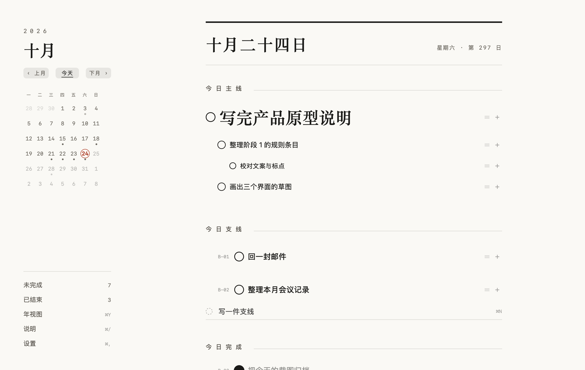
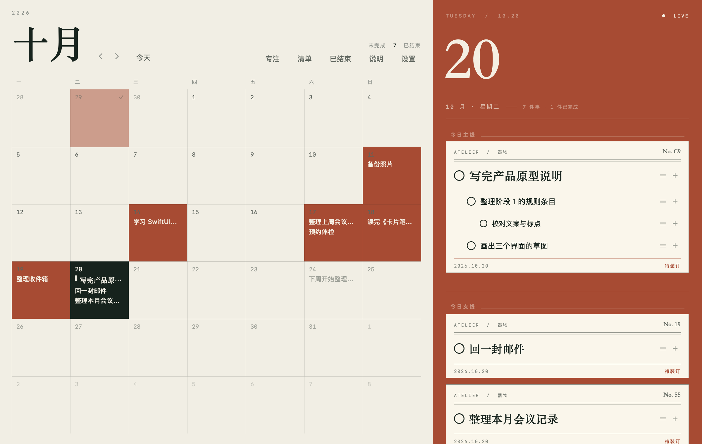
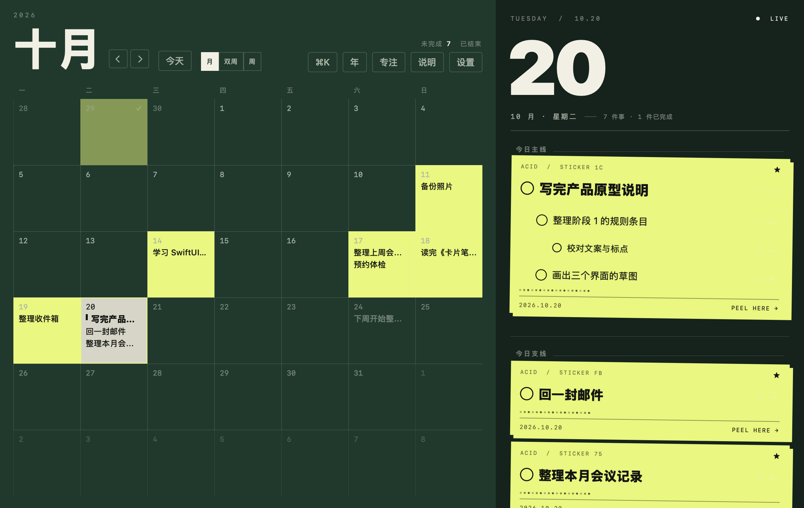
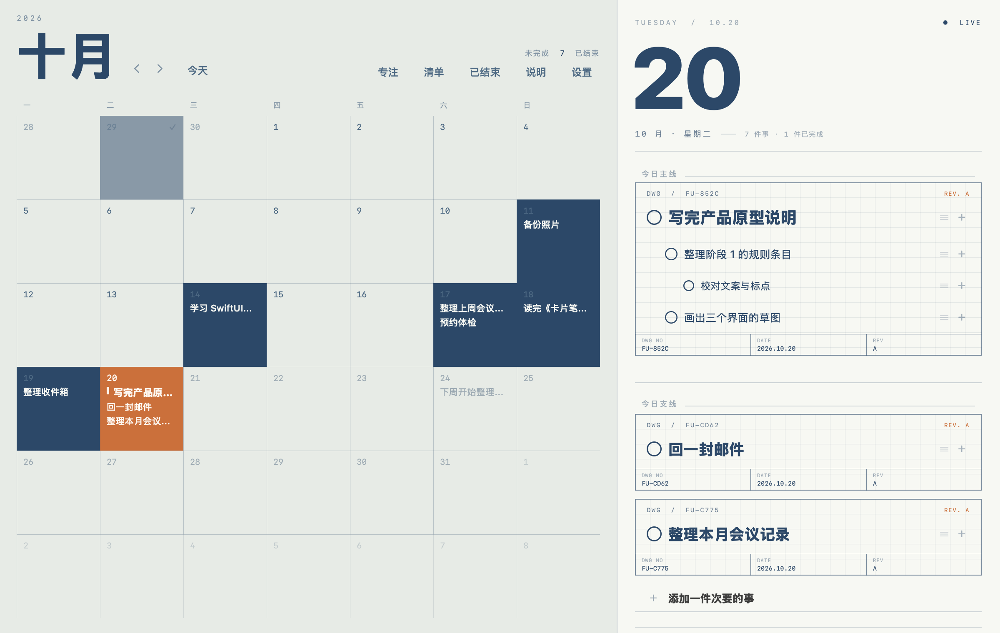
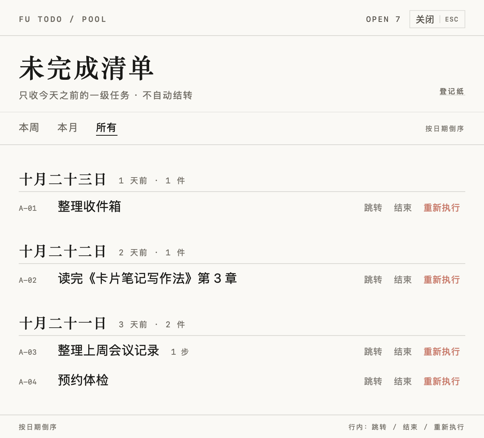
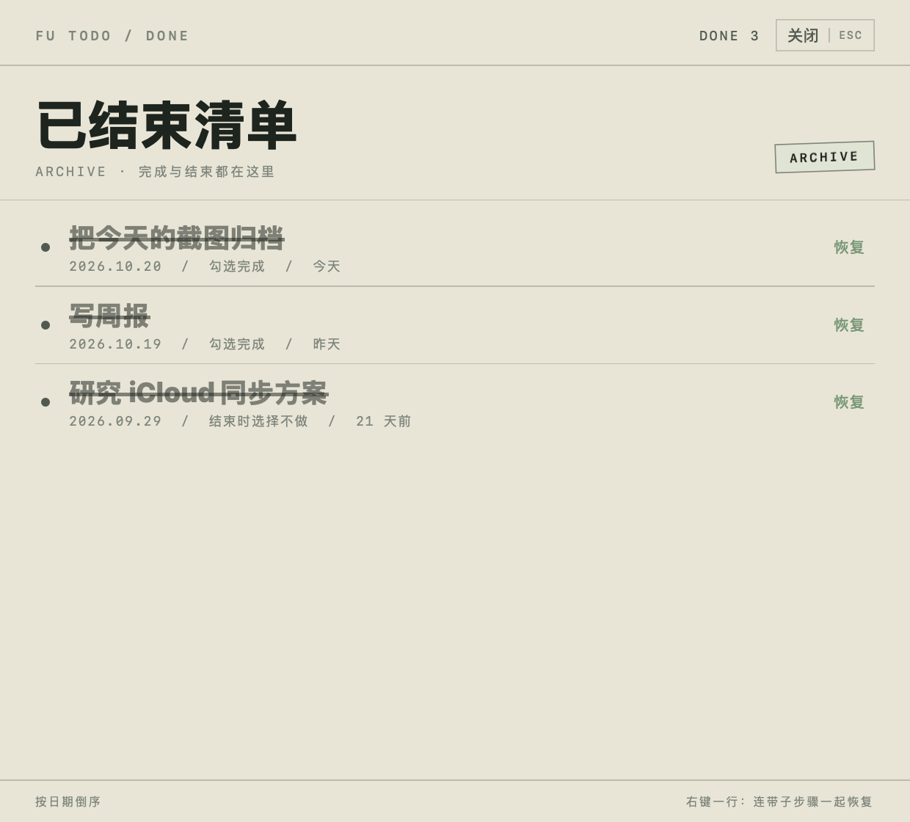
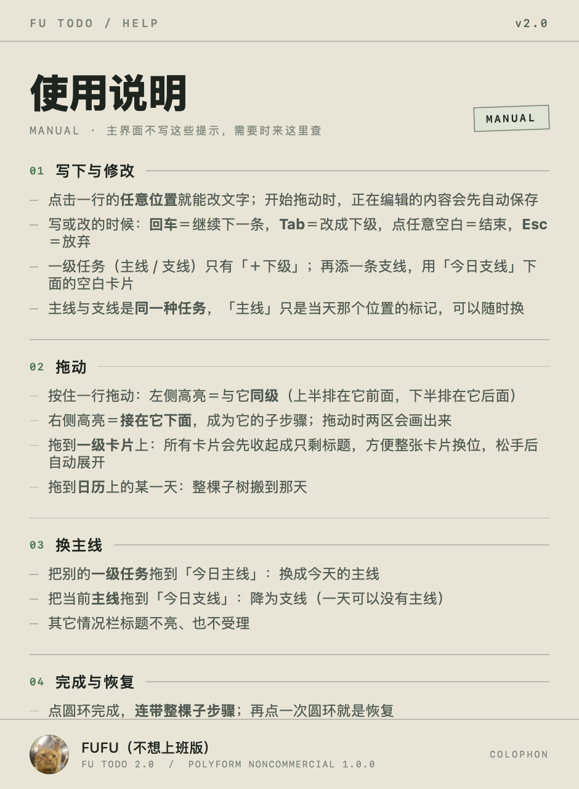

# FU ToDo

## ⬇️ 下载安装

**[→ 点这里下载最新版](https://github.com/fufer97/FU-ToDo/releases/latest)**

打开页面后在 **Assets** 一栏点 `FU-ToDo-<版本>.dmg`：

1. 双击 dmg 挂载
2. 把 **FU ToDo** 拖进「应用程序」
3. 首次打开 **右键 → 打开**（ad-hoc 签名，放行一次即可）

需要 macOS 14 或更高。[**→ FUToDo 2.0 发布页（单文件，可直接转发）**](<docs/04-版本发布/FUToDo 2.0发布页.html>)

---

一个把「一天一件」做成纸质实物的 Mac 每日计划应用：**一天一件最重要的事 + 若干支线**，写不下的自动进「未完成项目清单」，每天自动开新的一天，不结转、不堆积。

四套浅色主题，每套主题有自己的配色、字体和卡片物种：**器物**（奶油纸 / 宋体 / 墨绿工单）、**标本室**（鼠尾草 / 窄黑体 / 标本标签与条码，默认）、**酸纸**（黑绿底 / 重黑体 / 荧光贴纸）、**蓝图**（图纸底 / 蓝墨 / 标题栏与修订章）。

灵感来自「活页本 + 便利贴」的纸质计划法，做成了原生 macOS 应用（SwiftUI，无第三方依赖）。



## 它长什么样

| 界面 | 说明 |
|---|---|
|  | **标本室**：左边细线月历、有内容的日子整格上色；右边是当天的整页标本卡 |
|  | **器物**：奶油纸 + 墨绿日历块 + 宋体工单 |
|  | **酸纸**：黑绿底 + 荧光贴纸，最冲的一档 |
|  | **蓝图**：图纸底 + 标题栏 + 修订章 |
|  | 未完成项目清单：一页登记纸，只列一级任务，可「跳转 / 结束 / 重新执行」 |
|  | 已结束清单：按日期倒序，随时「恢复」 |
|  | 使用说明是独立窗口，一本薄手册 |

## 设计要点

- **一天一件**：每天至多一条「主线」，其余都是「支线」；主线只是当天那个位置的标记，和支线是同一种任务
- **卡片即实物**：每个主题的卡片是那个世界的一件东西——工单 / 标本标签 / 贴纸 / 图纸标题栏；内容与交互完全一致
- **拖动即整理**：行内左半边＝同级（上/下决定前后）、右半边＝衔接（成为子步骤）；拖动整张卡片时所有卡片会收起成标题列表
- **不惩罚没做完**：跨天自动开新的一天，旧任务进未完成清单，随时「重新执行」搬回今天
- **主题即世界**：四套浅色主题各自带配色、字体与卡片物种；主界面不写说明性文案、不堆统计

## 构建与运行

需要 macOS 14+ 与 Swift 6 工具链（命令行工具即可，不需要 Xcode）。

```bash
cd app
./build.sh          # 编译 + 自测 + 组装 dist/FU ToDo.app
./build.sh run      # 编译并启动
./build.sh dmg      # 生成 dist/FU ToDo.dmg 安装包
```

> 注意：`swift build` 在本机需要用 `--disable-sandbox`（构建脚本已处理）；`hdiutil` 建 dmg 需要在普通终端执行。

## 文档

按产品流程逐阶段产出，都在 `docs/`：

- `01-业务流程图/`：业务流程图、状态机图（可交互 HTML）+ 业务规则说明（规则的单一来源）
- `02-产品结构图/`：产品结构图 + 结构说明（含字号表、配色对比度底线、界面克制度）
- `03-产品原型/`：早期原型（已被阶段 4 的实现取代，留作记录）
- `04-版本发布/`：FUToDo 2.0 发布页（单文件 HTML，图片全部内嵌，可直接发给别人）

## 许可证

[PolyForm Noncommercial License 1.0.0](LICENSE) © 2026 FUFU

- ✅ 个人使用、学习、研究、 hobby 项目、非营利组织与教育机构使用
- ❌ **商业使用需另行取得授权**（联系仓库作者）
- 分发时请一并保留 `LICENSE` 与 `Required Notice` 行

## 版本

版本号单一来源：`app/Sources/Core/AppVersion.swift`。当前 **2.0.1**。
